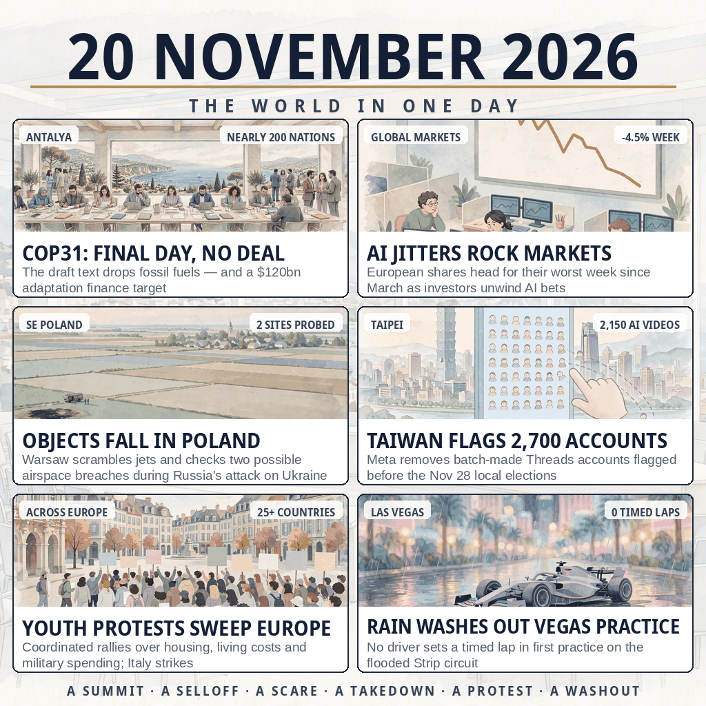

# 20 November 2026 — The World in One Day

[](https://make.fun/competitions/news-image-20261120)
[](https://make.fun/competitions/news-image-20261120)
[](https://make.fun/competitions)



One 1024×1024 front page that sums up a single day of world news —
**20 November 2026**, named in large type at the top. Six panels in a
2×3 grid over one shared backdrop (a pale summit hall above a
Mediterranean coast), each with a drawn scene, a location tag, a
headline, one line of fact, and the day's key number as a chip.

## The six stories

1. **Antalya — COP31: final day, no deal** · chip: *nearly 200 nations*
   The UN climate talks reach their scheduled final day in Antalya
   with no deal in sight; the draft text drops any mention of fossil
   fuels and the proposed $120bn adaptation finance target.
   Sources: Reuters; AFP.
2. **Global markets — AI jitters rock markets** · chip: *-4.5% week*
   European shares fall about 1% on Friday, on track for a weekly loss
   over 4.5% — the steepest since March — as investors unwind AI bets
   despite a new tech listing's debut; the dollar nears a 19-month high.
   Sources: Reuters.
3. **SE Poland — Objects fall in Poland** · chip: *2 sites probed*
   During Russia's massive overnight attack on Ukraine, unidentified
   objects fall in two villages in south-eastern Poland, about 45 km
   from the border. Warsaw scrambles jets and checks two possible
   airspace violations; no one is hurt.
   Sources: Reuters; Kyiv Independent.
4. **Taipei — Taiwan flags 2,700 accounts** · chip: *2,150 AI videos*
   Taiwan's digital ministry flags about 2,700 China-linked Threads
   accounts to Meta ahead of the Nov 28 local elections; some 260 of
   them spread more than 2,150 AI-generated videos. Meta removes the
   flagged accounts.
   Sources: Reuters; Taipei Times.
5. **Across Europe — Youth protests sweep Europe** · chip: *25+ countries*
   A coordinated day of youth demonstrations across more than 25
   countries over living costs, housing, education and militarisation,
   backed by 50+ student and youth groups; Italy's CGIL union holds a
   general strike the same day.
   Sources: AFP.
6. **Las Vegas — Rain washes out Vegas practice** · chip: *0 timed laps*
   Heavy rain floods the Strip circuit on Thursday night local time:
   no driver sets a timed lap in first practice for the Las Vegas
   Grand Prix, with only about 20 laps completed in total.
   Sources: Reuters; Autosport.

Every story is an event of 20 November 2026 (in its local time zone),
cross-checked against at least two reliable reports before it was
drawn. Reporting that turned out to describe 19 November events —
however prominent in Friday's papers — was left out.

## How it was made

The backdrop and the six scenes were drawn as separate illustrations
in one consistent flat, watercolour style, with no text in the artwork
itself. All type — the date, headlines, fact lines, tags and number
chips — was then set programmatically over the artwork, so every word
and figure is exact and legible. The sheet follows the house style of
the previous day's entry: one shared light backdrop behind all six
panels, a white text block under each scene, and a one-line inventory
along the bottom: *a summit · a selloff · a scare · a takedown · a
protest · a washout*.

## Run it

```sh
bun run main.ts
```

`main.ts` verifies `entry.png` against the intake limits (PNG
signature, IHDR dimensions at most 1024×1024, at most 1 MiB), stages
it into `output/`, and confirms the staged copy is byte-identical by
SHA-256.

## License

MIT — see [LICENSE](LICENSE).
